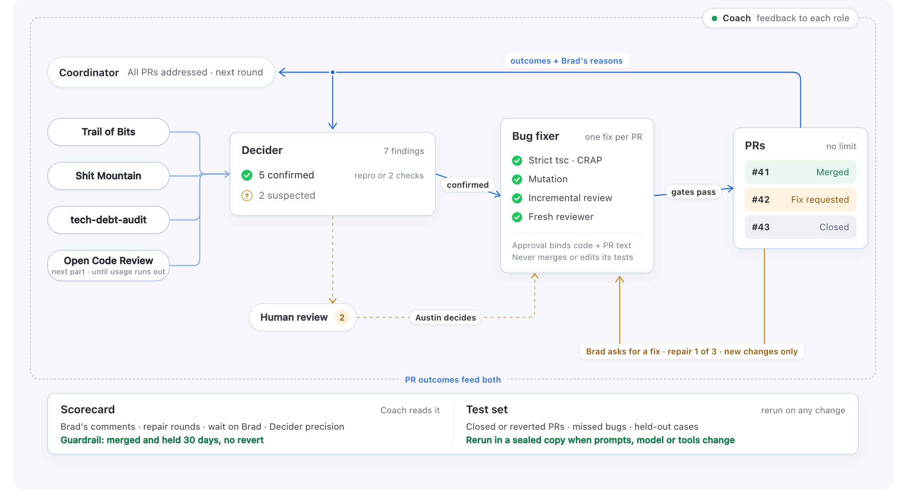

# Roadmap bug-fix process

An automated loop that finds, confirms, fixes, and opens PRs for real bugs in
[DrBradStanfield/roadmap](https://github.com/DrBradStanfield/roadmap), with the maintainer (Brad)
as the only person who merges.

This repo is the complete kit: the process, every agent's prompt template, the code standard,
the gates, the scripts, schedules, diagrams, and the real track record so far. It is written so
that **any capable coding agent can pick up the work from this repo alone**, including Brad's own
agent if Austin stops running it.



Animated version: [diagrams/bug-fix-loop-animated.mp4](diagrams/bug-fix-loop-animated.mp4).
Editable version (Mermaid): [diagrams/README.md](diagrams/README.md).

## The loop in one minute

1. **Coordinator** starts a round, but only once every PR from the last round has been
   *addressed* (merged, closed, or a maintainer comment asking for a change; CI and bots don't count).
2. **Four finders** run: Trail of Bits skills, fuck-my-shit-mountain, tech-debt-audit, and Open
   Code Review (which scans a new part of the repo each round until its model usage runs out).
3. **Decider** removes duplicates and **always confirms** a bug before any fix: a failing test or
   reproduction at the pinned commit, or a traced path agreed by two independent checks. Anything
   below that bar, and anything that needs a product, policy, clinical, schema, or security-policy
   decision, goes to the **human review list**. Security issues go to Brad **privately**.
4. **Bug fixer** makes one fix per PR, to the code standard, and must pass the gates: strict tsc,
   CRAP, mutation ratchet, incremental review, and an independent fresh reviewer. It cannot edit
   the tests that judge it and **never merges**.
5. **PRs** carry Testing / Risk / How to revert. There is no PR limit for confirmed real bugs.
6. **Brad** merges, closes, or asks for a fix. Repairs happen only when Austin or Brad asks,
   at most 2 to 3 rounds, reviewing only new changes; then it escalates to a human.
7. Outcomes and Brad's reasons feed back to the Decider, the **Scorecard**, and the **Test set**.
   The **Coach** watches everything, changes nothing, and gives feedback.

## Hard nevers

- Never merge. Never mark our own work approved.
- One fix per PR.
- Public content is synthetic only: no real user, patient, or health data anywhere.
- Security findings never appear in public. See [docs/security-findings.md](docs/security-findings.md).
- Bot comments never count as approval, and never contain a `VERDICT:` line (the repo's
  auto-ship workflow reacts to `VERDICT: APPROVE`).
- A new commit voids any earlier approval.

## Map of this repo

| Folder | What's in it |
|---|---|
| [docs/process.md](docs/process.md) | **Start here.** The full loop, routing, state layout, all rules |
| [docs/roles.md](docs/roles.md) | Who and what may do which action |
| [docs/evidence-bar.md](docs/evidence-bar.md) | What counts as a confirmed bug |
| [docs/code-standard.md](docs/code-standard.md) | The code standard the Bug fixer meets |
| [docs/quality-gates.md](docs/quality-gates.md) | The per-PR gates and how they are judged |
| [docs/independent-review.md](docs/independent-review.md), [docs/repair-rounds.md](docs/repair-rounds.md), [docs/regression-review.md](docs/regression-review.md) | Review and repair |
| [docs/validation-and-sandbox.md](docs/validation-and-sandbox.md) | Offline sandbox, full suite, live checks |
| [docs/pr-description-template.md](docs/pr-description-template.md) | PR body rules |
| [docs/human-review-and-escalation.md](docs/human-review-and-escalation.md) | When to stop and ask |
| [docs/security-findings.md](docs/security-findings.md) | Private reporting procedure |
| [docs/open-code-review-pipeline.md](docs/open-code-review-pipeline.md) | The Open Code Review finder pipeline |
| [docs/publishing.md](docs/publishing.md), [docs/scheduling.md](docs/scheduling.md), [docs/status-reporting.md](docs/status-reporting.md) | Running it |
| [docs/coordination-with-brads-agent.md](docs/coordination-with-brads-agent.md) | Working alongside Brad's agent |
| [docs/repo-triage-notes.md](docs/repo-triage-notes.md) | Repo-specific lessons that flipped verdicts |
| [docs/scorecard-and-test-set.md](docs/scorecard-and-test-set.md) | How the loop is measured |
| [docs/open-questions.md](docs/open-questions.md) | Unsettled decisions and their working answers |
| [docs/decisions.md](docs/decisions.md) | Changes to the process, why, and what would undo them |
| [docs/prioritization.md](docs/prioritization.md) | How the Coordinator picks what each round works on |
| [docs/trial-static-site.md](docs/trial-static-site.md) | One full trial run on a different repo, and what it changed |
| [agents/](agents/) | Copy-paste prompt templates for every agent |
| [templates/](templates/) | PR body and JSON schemas for findings, gate results, reviews |
| [scripts/](scripts/) | Portable scripts: OCR pipeline, publish driver, Coach watch and feedback items, outcome data, kit checker |
| [tests/](tests/) | Tests for the publish driver and for the kit's own consistency |
| [schedules/](schedules/) | Cron, launchd, and Hermes Agent job examples |
| [data/](data/) | Real public PR outcomes, scorecard baseline, test-set seed |
| [diagrams/](diagrams/) | Still, animation, Mermaid, animation source |

## Picking this up (for Brad's agent, or anyone new)

1. Read [docs/process.md](docs/process.md), then [docs/roles.md](docs/roles.md) and
   [docs/evidence-bar.md](docs/evidence-bar.md).
2. Read [docs/open-questions.md](docs/open-questions.md) and settle what you can with Brad.
3. Check the state of the last round: list open PRs from the previous operator in
   [data/pr-outcomes.csv](data/pr-outcomes.csv) (regenerate it first with
   `scripts/data/pr_outcomes.py`). Do not start a round while any is unaddressed.
4. Set up the finders you have access to. Each template in [agents/finders/](agents/finders/)
   says what tool it needs. Open Code Review needs the `ocr` CLI and a model provider; see
   [scripts/ocr/README.md](scripts/ocr/README.md).
5. Run one round by hand, following the agent templates in order, before scheduling anything.
   Scripts here are sanitized from a working setup: review them before running.
6. Schedule it ([docs/scheduling.md](docs/scheduling.md)) only after a hand-run round produced
   PRs Brad was happy with.

If Brad is the operator, "Brad" in these docs is still the merge decision, and "Austin" becomes
whoever else is available as the human reviewer. Nothing here requires Austin's accounts.

## What transfers, and what has actually been run

The process, the evidence bar, the gates and the schemas are written for any capable coding agent.
That does not mean they have been run everywhere. This table claims only what has been run:

| Part | Run in practice | Not yet run |
|---|---|---|
| Publish driver, OCR mechanics, outcome script | macOS, Python 3, `gh`, `git`, `gitleaks` | Linux (expected to work; the scripts avoid GNU-only tools), Windows |
| Scheduling | Hermes Agent jobs | launchd and plain cron (examples only) |
| Agent templates | One agent runtime, on DrBradStanfield/roadmap and one static-site trial ([trial-static-site.md](docs/trial-static-site.md)) | Other agent runtimes |
| Finders | FMSM, tech-debt-audit and Open Code Review on DrBradStanfield/roadmap (each has merged PRs in [pr-outcomes.csv](data/pr-outcomes.csv)) | Trail of Bits: no PR attributed to it yet. Other repos, apart from the trial |

What does not transfer without work: the repo-specific notes ([repo-triage-notes.md](docs/repo-triage-notes.md)),
the known-flaky test list in the driver, the Risk table's clinical rows, and the test-set cases.
If you run this somewhere new, please send a [field report](https://github.com/robertaustinbell/roadmap-bugfix-process/issues/new?template=field-report.yml):
what you ran, on what, and what broke.

## Checking the kit

```sh
python3 -m unittest discover -s tests    # driver gates, schema/template drift, the checker itself
python3 scripts/mutation_check.py        # remove each publish gate; every removal must fail a test
python3 scripts/check_kit.py             # public scrub, links, required rules, orphan templates
```

CI runs all three on every push ([.github/workflows/check.yml](.github/workflows/check.yml)).

## Status

Process as adopted 2026-11-02, hardened 2026-11-03 ([what changed and why](docs/decisions.md)). Real outcomes to date are in [data/scorecard-baseline.md](data/scorecard-baseline.md).

## License

MIT, matching the roadmap repo. See [LICENSE](LICENSE).
