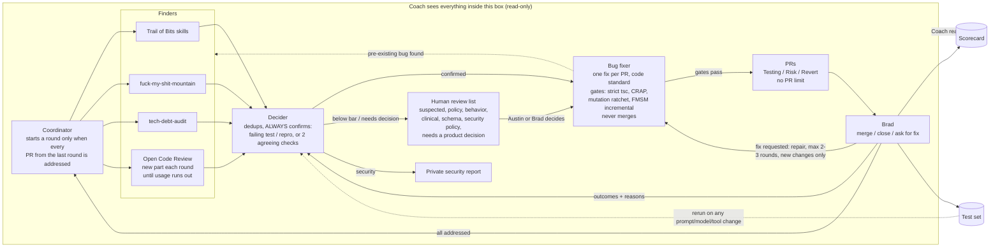

# Diagrams

| File | What |
|---|---|
| [bug-fix-loop.png](bug-fix-loop.png) | Still of the whole loop |
| [bug-fix-loop-animated.mp4](bug-fix-loop-animated.mp4) | 16-second animation of one round |
| [stageshow-src/](stageshow-src/) | Source for the animation ([Stageshow](https://github.com/benjitaylor/skills) example; drop into its `examples/` folder) |
| Mermaid below | Editable text version; GitHub renders it |

The numbers in the still and animation (7 findings, PRs #41 to #43) are illustrative, not real.
Real numbers are in [../data/](../data/).

Austin's working copy of the graph is an Apple Freeform board. If you change the process, update
the Mermaid diagram below first; it is the version anyone can edit.

