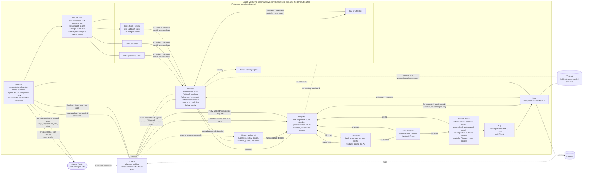

# Diagrams

| File | What |
|---|---|
| [bug-fix-loop.png](bug-fix-loop.png) | Still of the whole loop |
| [bug-fix-loop-animated.mp4](bug-fix-loop-animated.mp4) | 14-second animation of one round |
| [stageshow-src/](stageshow-src/) | Source for the animation ([Stageshow](https://github.com/benjitaylor/skills) example; drop into its `examples/` folder) |
| Mermaid below | Editable text version; GitHub renders it |

The numbers in the still and animation (7 findings, PRs #41 to #43) are illustrative, not real.
Real numbers are in [../data/](../data/).

Austin's working copy of the graph is an Apple Freeform board. If you change the process, update
the Mermaid diagram below first; it is the version anyone can edit and the most complete one. The
still and the animation are simplified: they show the round, not the Coach's feedback arrows or
the publish driver.

The Coach's arrows to and from the Coordinator, Decider and Bug fixer stand for every role:
finders, the reviewer, repair and the OCR agent read and answer their items the same way
([roles.md](../docs/roles.md#how-coach-feedback-reaches-a-role)).
