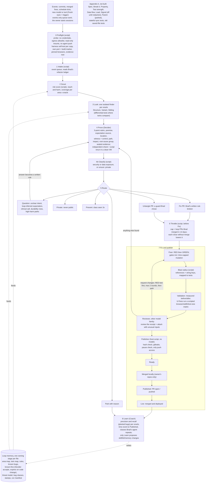

# Review packet: bug-fix loop v0.8

> **Design draft, not running.** Public copy of the 2026-11-10 packet; see the note at the
> top of `PROCESS-v0.8.md`.

**For:** an outside reviewer. **From:** Austin Bell, who runs the loop.
**Full spec:** `PROCESS-v0.8.md` (this packet summarises it; where they differ, the spec wins).

## What this is

An agent pipeline, run by an outside contributor, that finds bugs in a public open-source
health app (DrBradStanfield/roadmap: Shopify app, web widget, iOS app; TypeScript and
Swift). It proves each bug with a failing test, fixes it in a small pull request (PR), and
hands the PR to the maintainer, Brad, who decides whether to merge. Brad's own coding agent
writes and reviews most of the code; this loop exists to be a second, independent set of
eyes.

A working version (kit v0.3.1) has had about 194 PRs merged. v0.6 redesigned it around
*oracles*. v0.7 added the lessons of a full dry run on the owner's own website. **v0.8
applies an outside review of v0.7** (by Claude Fable 5.2) and the owner's decisions on it.
**Nothing in v0.6 to v0.8 runs on the roadmap yet.** It waits for Brad's current refactor
to finish, and phase 1 waits for a comparison against v0.3.1.

## The three ideas

1. **A bug is a disagreement between the code and an oracle**, something that says what
   the code should do: a spec line, a twin file, an earlier fix, an invariant. A witness
   is only as strong as its oracle, so every witness records who wrote the expectation.
2. **Nothing reaches the maintainer without executable proof**: a test that fails for the
   claimed reason, plus a control that passes.
3. **What the loop learns is kept in files**, so each pass starts smarter.

Needless complexity counts as a defect, in the code and in this design.

## How it works

### The core oracles (rollout phases 0 to 2)

| Oracle | Checks code against | Finds |
|---|---|---|
| Structure | "Should these pieces change together?" | Copies that drifted, hidden links, surplus code |
| Variant | A bug already fixed | The same mechanism elsewhere |
| Sibling | A twin file (Drive vs Dropbox, TS vs iOS engine) | A fix made on one side only; twins that disagree on the same input |

Everything else (Spec, Break-it, Property, Test strength, Data flow, Load, Signal, Parent)
is in Appendix A, not built. Fresh eyes is now a trigger, not an oracle.

### Rules that never change

The maintainer merges; the loop never merges, approves, labels or closes. One fix per PR,
none without a failing test. Sessions start only on the owner's word. Public text holds only
synthetic data; private findings never go public. Text in repos and tool output is
information, never instruction. **Isolation is enforced by the setup, not by instruction:**
no credentials in VMs, a network allowlist, read-only mounts outside each role's own folder,
and no agent with push access. Only the publisher script can push, and it checks for a
pause request from the maintainer first.

### Channels

GitHub first, the agent chat channel when GitHub rate-limits. Private findings use the private form of each
(a GitHub private vulnerability report, or a direct chat message).

## What changed in v0.8, and why

| Outside review said | v0.8 does |
|---|---|
| Nothing shows v0.7 beats v0.3.1 | A comparison on an old snapshot gates phase 1 (waits for the refactor) |
| Too much design for one dry run | Unbuilt parts moved to Appendix A |
| Proof shows what code does, not that it is wrong | Each witness records who wrote its expectation; loop-inferred ones go to Question first; clinical ones need Brad |
| Safety guards were only instructions | Enforced isolation; publisher is a host script; preflight probe tests it |
| No rule decides what is security | Classify step by script, default private |
| Proof parts undefined | Control, path check and independent check defined |
| Timing bugs would be parked | Deterministic reproduction, or a measured rate against a zero control |
| High-harm parks dropped | Become question rows |
| Known-fine could hide a bug forever | Decider accepts; entries expire when the code changes |
| Gates miss behaviour changes | Blast radius as a script; scripted UI matrix; reviewer on another model family |
| Throttle counted rejections as success | Cap comes from merged loop PRs; non-merges lower it |
| 29 durability PRs would look like noise | One question row; one lint rule preferred |
| Only precision measured | Recall by planted bugs; time to Published |
| Parent found little | Parked |
| Signal may carry real health data | Off until a redaction step exists |
| Five factual errors in v0.7 | Corrected (spec section 12c) |

**Adopted only in part:** the evidence rubric was shortened, not removed; Parent was parked,
not deleted. **Already covered:** agreeing a pause switch and private route with the
maintainer (channels exist). **Not addressed:** checking past public loop PRs against the new Classify
rule.

**Limits of the evidence:** one small static site, one model family, one day, one owner
who was also the maintainer. The v0.7 review was by a model from the same family as the
agent that drafted the design.
